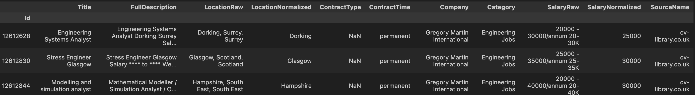
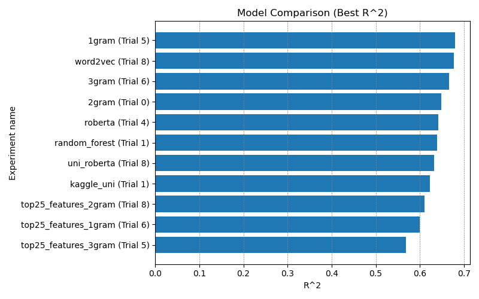
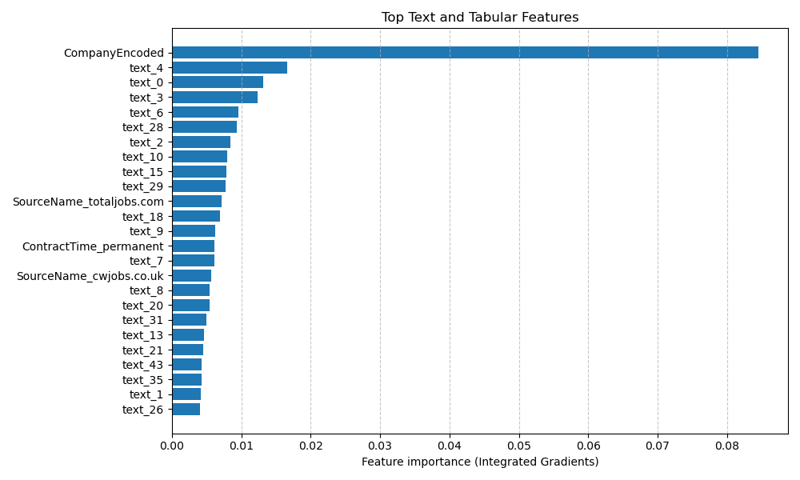
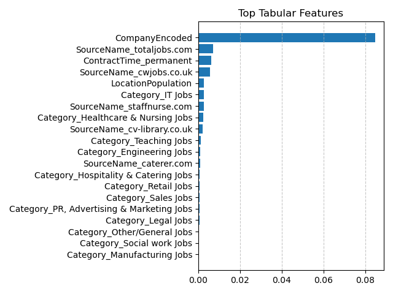

# Job Salary Prediction

This project focuses on **predicting salaries based on job advertisements**. Several **multimodal models**, combining **textual** and **tabular data**, were compared to evaluate their performance.

## Dataset

The main dataset **`Job Salary Prediction`** is available [here: ](https://www.kaggle.com/competitions/job-salary-prediction/data)

  

### Converting Location to Population

The dataset contains text columns such as `Title`, `FullDescription`, `LocationNormalized`, and `Company`.

As part of data preprocessing, the `location` column, which originally contained **city, region, and country names**, was converted into the **population of the corresponding location**.  

Population data was collected in two ways:  

1. **Web scraping from Wikipedia**  
2. **Using popular datasets:**
  - [GeoNames](https://download.geonames.org/export/dump/)
  - [NUTS (UK Boundaries)](https://www.data.gov.uk/dataset/ba66b4fc-34a0-4323-ae9a-118ab8929552/nuts-level-1-january-2018-boundaries-uk-bsc?utm_source=chatgpt.com)  

### Text Embedding Methods

The `Title` and `FullDescription` columns were processed using the following methods to convert text into numerical embeddings:  

- **Tf-idf**  
- **Word2Vec**  
- **N-grams** (uni-, bi-, tri-)  
- **Transformer (Roberta)**  

### Other

The `Company` column was preprocessed using target encoding, replacing it with the average salary for each company.  
Additionally, the `SourceName` column was limited to the most common platforms in each category.

## Model Comparison

Model comparison focused primarily on the text processing methods. In addition, **neural networks** and **random forests** were evaluated.  

The `kaggle_uni` model was used to estimate potential Kaggle ranking, achieving **39th place**. This result reflects a late-stage experiment using the competition's test set and was not intended to achieve the absolute best performance. The primary goal of the project was to **explore and learn different methods**, rather than performing extensive training for maximum score.



### Feature Importance Analysis

To simplify the model, the **25 most important features** were selected using **Information Gain (IG)**.

- **All features:**  
  
- **Tabular features only:**  


## Project Structure

```
├── notebooks/           # Jupyter notebooks (preprocessing, regression experiments)
├── src/                 # reusable code (model, tools, preprocessing, data build scripts)
├── data/
│   ├── raw/             # original Kaggle dataset (downloaded - see Getting the Data)
│   ├── external/        # GeoNames, NUTS (generated by src/build_*.py), Kaggle results
│   └── processed/       # preprocessed tables and text embeddings (generated)
├── plots/               # figures used in this README
└── logs/                # experiment logs (created at runtime, gitignored)
```

## Setup

```bash
pip install -r requirements.txt
```

## Getting the Data

Large data files are **not tracked** in this repository (Git LFS is not used).
Download or generate them locally into the folders below.

### 1. Raw dataset → `data/raw/`

Download `Train_rev1.csv` (and `Test_rev1.csv` for the competition test set)
from the [Kaggle competition page](https://www.kaggle.com/competitions/job-salary-prediction/data)
(account + rules acceptance required):

```bash
pip install kaggle
kaggle competitions download -c job-salary-prediction -p data/raw
unzip data/raw/job-salary-prediction.zip -d data/raw
```

### 2. External data → `data/external/`

- `geonames_gb.csv` — GB locations with population, generated from the
  [GeoNames](https://download.geonames.org/export/dump/) dump:
  ```bash
  python src/build_geonames_gb.py
  ```
- `NUTS.xlsx` — NUTS Level 1 (January 2018) regions and centroids from the
  [ONS Open Geography Portal](https://www.data.gov.uk/dataset/ba66b4fc-34a0-4323-ae9a-118ab8929552/nuts-level-1-january-2018-boundaries-uk-bsc):
  ```bash
  python src/build_nuts_xlsx.py
  ```
- Optional (only for the Kaggle ranking estimate): `results.csv` (test-set
  ground truth) and `leaderboard.csv` from the competition.

### 3. Processed artifacts → `data/processed/`

Generated from the raw data:

```bash
python src/preprocessing.py    # TF-IDF variant: train/test split + embeddings
```

or run the full `notebooks/preprocessing.ipynb` to produce all embedding
variants (TF-IDF n-grams, Word2Vec, RoBERTa) used by `regression.ipynb`.
